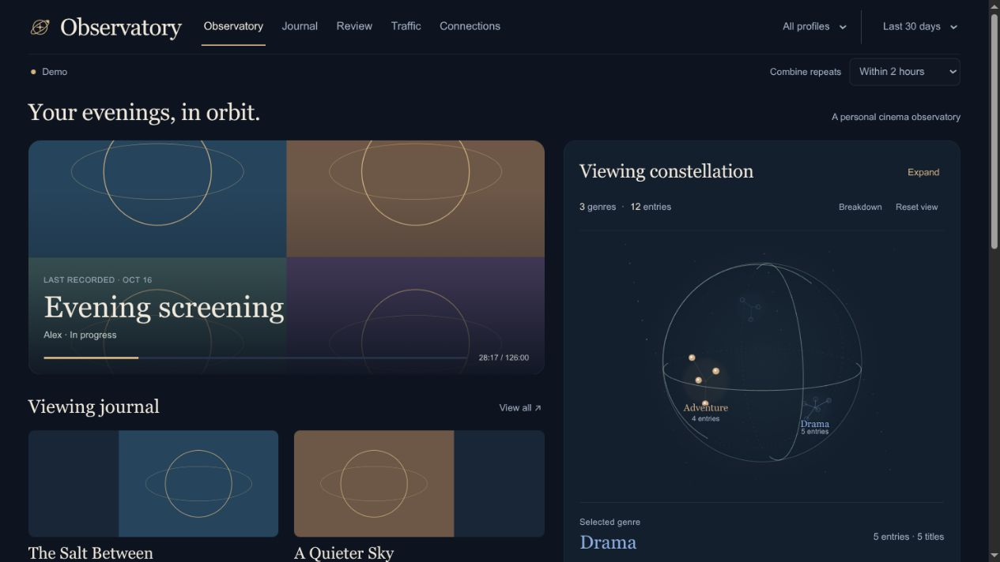

# Observatory

A self-hosted viewing journal and visual dashboard for AIOMetadata playback records and AIOStreams NNTP download statistics. Includes a rotatable genre constellation, searchable journal, month/year reviews, and download charts.



Observatory is a **single-owner dashboard**. Everyone who signs in can see all collected profiles. It is not a multi-tenant service.

## Try it with Docker

Install Docker Engine with Compose v2. From a clean checkout:

```sh
cp .env.example .env
mkdir -p .secrets
docker compose up --build -d
```

Open http://127.0.0.1:8080. The default is demo mode with synthetic records and original abstract artwork. No upstream credentials or connections are needed. Prebuilt Linux AMD64 and ARM64 images are published at `ghcr.io/jeor/observatory`. To use version 0.1.0 instead of building locally, add `OBSERVATORY_IMAGE=ghcr.io/jeor/observatory:0.1.0` to `.env`, then run:

```sh
docker compose pull
docker compose up -d --no-build
```

[Release v0.1.0](https://github.com/Jeor/observatory/releases/tag/v0.1.0) · [Docker build workflow](https://github.com/Jeor/observatory/actions/workflows/release.yml)

Version 0.1.0 passed both architecture smoke tests in GitHub Actions. Remote HTTPS/proxy configuration still needs validation in your deployment.

## Connect your services

Set these values in `.env`:

```dotenv
OBSERVATORY_MODE=live
OBSERVATORY_TIMEZONE=Europe/London
OBSERVATORY_AUTH_FILE=/run/secrets/dashboard-login.json
AIOM_ORIGIN=http://your-aiometadata:3232
STREAMS_ORIGIN=http://your-aiostreams:3004
```

Origins must be reachable **from the container**. They cannot contain a path, query string, or embedded credentials. Use container DNS on a shared network or a reachable server address; localhost inside the container is Observatory itself. Either source can be omitted.

Create these files locally, never in Git:

| File under `.secrets/` | Contents |
|---|---|
| `dashboard-login.json` | `{"username":"owner","password":"REPLACE-WITH-A-UNIQUE-LONG-PASSWORD"}` |
| `aiom-key` | Your existing AIOMetadata admin key, one line |
| `aiom-config` | Your AIOMetadata configuration UUID, one line |
| `streams-login.json` | JSON with your existing AIOStreams admin `username` and `password` |

The dashboard password must be at least 16 characters. Replace the example password. It is separate from your upstream logins. The image runs as UID/GID 1000: ensure only the owner/container identity can read the secret directory and files. On a Linux host, an administrator can set ownership to 1000:1000, directory mode 700, and file mode 600. Do not make secrets world-readable to solve permissions problems.

Run `docker compose up -d` after configuration changes. View `docker compose logs observatory` and the Connections page for status. Invalid zones/credentials fail startup; partial upstream settings may leave the relevant connection disabled.

## Private network and HTTPS access

The default Compose publishes to loopback only. Live mode listening on a non-loopback interface requires the dashboard login file. All HTML, data and artwork routes require that login; `/healthz` returns only a generic process-health result and is public.

For remote access use **HTTPS**. HTTP Basic authentication sends credentials on requests, so it must not be exposed over unencrypted networks. Do not forward the direct port publicly. Authentication is required even when an external identity provider also protects the dashboard.

A standalone Traefik example is provided in `examples/compose.traefik.yaml`. It expects an existing HTTPS `websecure` entrypoint, `letsencrypt` certificate resolver, and external Docker network named `proxy` (or `PROXY_NETWORK`). Change those names to match your installation. Set `OBSERVATORY_DOMAIN` in `.env` and run:

```sh
docker compose --env-file .env -f examples/compose.traefik.yaml up --build -d
```

This exposes no host port. `ALLOWED_HOSTS` is passed explicitly and must contain the hostname the browser uses, without scheme or port. It is a Host-header check, not an authentication mechanism. The example is structurally validated; certificate/DNS setup depends on your own Traefik installation.

### Unraid

Use the Dockerfile locally or a verified released GHCR image. Set container port 8080, `/app/data` to a dedicated appdata directory, and `/run/secrets` to a separate read-only secrets directory. Set the environment variables listed above and `ALLOWED_HOSTS` to your authenticated HTTPS hostname. Data must be writable by UID 1000; secrets readable by that UID. Attach Observatory to the proxy network. Do not mount the Docker socket or share another application's appdata directory. A named volume is the easiest option when using Compose.

## Compatibility and data coverage

This connector targets these upstream response contracts, not every historical release:

- AIOMetadata: `GET /api/dashboard/jellyfin/{configId}` using `x-admin-key`, with `inProgress`, `recentlyPlayed`, and optional profile-sharing records. Genre enrichment uses `/stremio/{configId}/meta/{type}/{id}.json`.
- AIOStreams: `POST /api/v1/auth/login` with the `aiostreams.session` cookie; `GET /api/v1/dashboard/usenet/stats?window=7d` with hourly `throughput`, `providers`, `generatedAt`, and `bucketMs: 3600000`.

Exact upstream release-version compatibility has not yet been established. Unsupported responses produce a connection error and preserve the last successful data. Before upgrading, verify the Connections page and keep an appdata backup.

The journal records saved playback state, including imported watched flags. It is **not measured watch time or an immutable history of every rewatch**. Source dashboard row limits bound initial history. Each profile/item stores its latest state, so later updates can move it between review periods. Explicitly shared upstream histories are merged; UI grouping is configurable.

Genres are fetched from metadata, at most four sequential lookups per playback poll; successful entries cache for a week and missing results for an hour. Unsupported artwork uses a placeholder. Only allowlisted public raster URLs are proxied; protected or SVG artwork is not fetched.

Traffic means upstream NNTP downloads, potentially including retries/buffering. It is not bytes watched, debrid usage, total internet traffic, or per-profile consumption. Provider totals are a separate rolling seven-day snapshot.

## Storage, updates and backups

SQLite persists in `/app/data`. Playback retention is 400 days; traffic retention is 365 days. Unused image mappings and expired genre cache entries are pruned. Artwork downloads are coalesced, limited to four concurrent fetches, and cached within a 32 MiB budget. API responses are gzip-compressed when supported, briefly cached, and support conditional requests; the browser refreshes every 15 seconds.

Stop the container before backing up its data directory and SQLite sidecars. Stored viewing history is private and unencrypted at rest. To update a source-built installation: back up, update the checkout, then `docker compose up --build -d`. With a published image, pin a version or digest and pull that version before recreating. Keep backups for rollback; future schema changes may not be downgrade-compatible.

Changing upstream origin, AIOMetadata configuration, or AIOStreams username requires a separate data directory. Password rotation with the same username does not. Cookie-only native installations must set a stable `STREAMS_ACCOUNT_SCOPE` and change it when the account changes.

### Migration from the local Afterglow prototype

`AFTERGLOW_MODE` is accepted as a legacy alias; `OBSERVATORY_MODE` takes precedence. Existing databases without account-identity metadata fail closed. After verifying that the stored history belongs to the currently configured accounts, start once with `OBSERVATORY_ADOPT_LEGACY_SCOPE=true`, then remove that flag. Do not use it to adopt someone else's database.

The new Compose service/volume names use Observatory. Existing prototype volumes are **not automatically renamed or deleted**. Back up and deliberately mount the old volume if you want to retain it. Native installations default to the former America/New_York zone for compatibility; new Compose installations explicitly default to UTC. Set `OBSERVATORY_TIMEZONE` to your desired IANA zone.

## Native development

Requires Node 24+, which provides native TypeScript stripping and SQLite:

```sh
npm ci --ignore-scripts
npm test
npm run build
npm run demo
```

For native live operation, supply `AIOM_ADMIN_KEY_FILE`, `AIOM_CONFIG_ID_FILE`, and `STREAMS_CREDENTIALS_FILE` as host paths, along with origins. Start with `node --env-file=.env.local server/main.ts`. Default bind is 127.0.0.1:8080; use `HOST`, `PORT`, and `DATA_DIR` as needed. Never commit `.env.local`. `npm run dev` starts Vite, proxying `/api` to 8080; it expects the API server running separately.

## Verification and releases

`npm test`, `npm run build`, and `node scripts/smoke.mjs` test logic and HTTP boundaries. `sh scripts/container-smoke.sh observatory:audit` checks a built image in isolated demo mode. Verification CI performs a dependency audit and container checks. Version tags trigger a GHCR release workflow that tests amd64 and arm64 before publishing with provenance/SBOM metadata. A workflow definition is not proof of a successful remote release.

`npm run release:prepare` creates an explicit allowlisted source package under ignored `releases/`. It excludes credentials, databases, personal screenshots, private reports and local debugging scripts. Review its contents before publishing. The application and first-party abstract demo artwork are licensed under GPLv3 only (GPL-3.0-only). Dependencies retain their own licenses. Live artwork is fetched from users' providers; it is not part of the released package.

## License

Copyright (c) 2026 Observatory contributors. Distributed under the GNU General Public License version 3 only. See [LICENSE](LICENSE) for the full terms.
